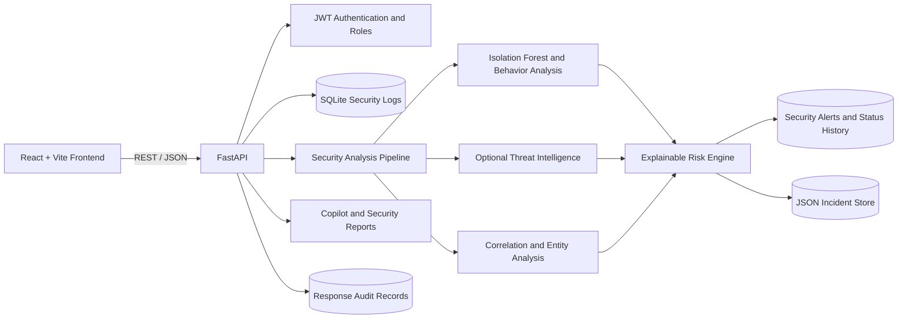

# AI Security Assistant

An AI-assisted cybersecurity monitoring and analysis prototype built with Python, FastAPI, SQLAlchemy, scikit-learn, React, and Vite. It normalizes security events, combines anomaly and behavior signals, enriches public indicators when configured, correlates attack sequences, and produces explainable risk and incident reports.

## Overview

The analysis pipeline combines:

- Isolation Forest anomaly scoring with a saved train/load/predict workflow
- Deterministic user-behavior scoring and historical risk context
- Optional VirusTotal v3 IP, domain, and file-hash lookups
- Attack-chain correlation and advanced event-pattern detection
- Multi-user and multi-IP entity analysis
- Explainable risk scoring on a 0-100 scale
- Rule-based Security Copilot explanations and recommendations
- Persistent incident history and an approval-gated response audit workflow
- Dashboard analytics over stored logs and alerts

The Copilot is local and rule-based; no external LLM is required.

## Architecture



See [docs/architecture.md](docs/architecture.md) for component responsibilities and the event-analysis flow.

## Features

### Authentication and access

- User registration, login, JWT access and refresh tokens
- Admin user and role management
- Login protection and rate limiting

### Machine learning and behavior

- Isolation Forest trained on a small synthetic baseline dataset
- Model persistence through joblib, with automatic loading and prediction
- Behavior signals for unusual login time, failed attempts, unfamiliar IPs, and activity frequency
- Historical risk weighting and model evaluation metrics

The included training data is a demonstration baseline, not a production-trained model. The evaluation endpoint uses fixed example labels to demonstrate metric reporting; its perfect score is not a measured real-world model result.

### Threat intelligence

- Extracts valid IP addresses, domains, and SHA-256 hashes
- Optional VirusTotal API v3 lookup for IP, domain, and file reports
- Non-public IP addresses are skipped and never sent to VirusTotal
- Without a configured API key, provider lookups return a neutral status and zero risk

Configure `VIRUSTOTAL_API_KEY` in `backend/.env` locally. Do not commit real keys or confidential indicators.

### Correlation, incidents, and response

- Correlates event sequences such as failed login -> successful login -> privilege change -> sensitive access
- Detects brute-force, possible account takeover, privilege escalation, repeated sensitive access, and multi-entity activity
- Calculates an explainable risk score from ML, behavior, threat intelligence, attack-chain, severity, and historical signals
- Persists incidents in JSON and security alerts in the database
- Produces staged incident timelines, reports, and rule-based Copilot summaries
- Response actions require analyst approval and create audit records; the prototype does not block IPs or modify external infrastructure

### Dashboard and APIs

- React dashboard for logs, alerts, risk breakdown, analytics, and Copilot results
- Analytics are loaded from stored security logs and alerts
- Manual refresh is supported; WebSocket streaming is not currently implemented

Useful endpoints:

- `POST /security/analyze` - run analysis and persist an alert when thresholds are met
- `POST /security/copilot` - analyze an event and return a rule-based explanation
- `POST /security/report` - return a structured incident report
- `GET /security/incidents` - retrieve persistent incident history
- `GET /security/incidents/correlated` - retrieve computed correlated incidents
- `GET /security/analytics` - aggregate event, severity, and risk distributions
- `POST /security/ml/train`, `POST /security/ml/predict`, and `GET /security/ml/evaluation` - model workflow and sample metrics

Interactive API documentation is available at `/docs` when the backend is running.

## Technology

- Backend: Python 3.13, FastAPI, SQLAlchemy, Pydantic
- ML and analysis: scikit-learn, NumPy, joblib
- Threat intelligence: requests, python-dotenv, optional VirusTotal API v3
- Frontend: React, Vite, JavaScript, CSS
- Storage: SQLite, JSON incident history
- Deployment configuration: Docker and Docker Compose

## Run Locally

### Backend

Create or activate a Python environment, install dependencies, and configure `backend/.env` with a unique random `SECRET_KEY`. A VirusTotal key is optional.

```powershell
cd "C:\AI Security Assistant"
.\venv313\Scripts\python.exe -m pip install -r requirements.txt
.\venv313\Scripts\python.exe -m uvicorn backend.app.main:app --reload
```

Backend: `http://127.0.0.1:8000`

Swagger: `http://127.0.0.1:8000/docs`

### Frontend

```powershell
cd "C:\AI Security Assistant\frontend-new"
npm install
npm run dev
```

The Vite development server normally runs at `http://127.0.0.1:5173`.

### Docker

Create `backend/.env` locally with a unique random `SECRET_KEY`; `VIRUSTOTAL_API_KEY` is optional. The file is ignored by Git and is loaded by Compose. Do not use the placeholder secret in a deployed environment.

```powershell
cd "C:\AI Security Assistant"
docker compose config
docker compose build
docker compose up -d
docker compose ps
docker compose logs --tail=100
```

The backend is exposed at `http://127.0.0.1:8000`; Swagger is at `http://127.0.0.1:8000/docs` and the health endpoint is `http://127.0.0.1:8000/health`. Compose stores the database, incident file, and model in a named volume.

## Testing

Run the full backend suite:

```powershell
cd "C:\AI Security Assistant"
.\venv313\Scripts\python.exe -m pytest -q
```

Run the dedicated backend pipeline regression:

```powershell
.\venv313\Scripts\python.exe -m pytest backend/tests -v
```

Build the frontend:

```powershell
cd "C:\AI Security Assistant\frontend-new"
npm run build
```

### Verification Record

- Full automated suite after authorization and route cleanup: **50 passed, 0 failed, 0 errors** in 18.19 seconds; 1,852 warnings.
- Security-focused subset: **30 passed, 0 failed** in 16.34 seconds; 1,707 warnings.
- Live API smoke checks: `/health`, `/logs`, `/security/failed-logins`, `/security/ml-analysis`, and `/dashboard/summary` returned HTTP 200.
- Docker Compose configuration parsed successfully; the backend container was running and `/health` returned `{"status":"healthy"}` during verification.

## Security Notes and Limitations

- Keep `backend/.env`, database files, trained model artifacts, and incident records out of Git.
- Replace the `SECRET_KEY` placeholder with a long, randomly generated secret before deployment.
- VirusTotal lookups are optional; private/internal IPs are filtered locally.
- The baseline model and sample evaluation data are illustrative and need representative labeled data and calibration before operational use.
- The response workflow records analyst-approved application actions; it does not perform network or endpoint remediation.
- Dashboard refresh is request-driven; there is no WebSocket event stream yet.
- `PUT /alerts/{alert_id}/status` now requires a valid JWT; admin user-management endpoints require the admin role.
- Duplicate alert, dashboard, and admin route registrations that caused OpenAPI operation ID warnings have been removed.
- The current application is a prototype and should receive deployment-specific security review before production use.

## Demo Flow

1. Log in and open the dashboard.
2. Review security logs and the current risk summary.
3. Run anomaly and threat analysis on security events.
4. Inspect generated alerts and investigate an alert.
5. Review alert status history and the related incident report.

## Resume Entry

**AI Security Assistant | Python, FastAPI, React, scikit-learn**

- Built a security-event analysis pipeline combining Isolation Forest anomaly scoring, behavior analytics, optional threat-intelligence enrichment, and multi-event attack correlation.
- Implemented an explainable 0-100 risk engine using ML, behavior, threat intelligence, attack-chain, severity, and historical-risk signals.
- Developed incident timelines, persistent incident history, structured reports, and a rule-based Security Copilot.
- Added approval-gated response recommendations with audit logging, model evaluation, attack simulation, and backend regression tests.
- Built a React dashboard for security logs, alerts, risk breakdowns, analytics, and Copilot explanations; configured Docker Compose deployment.

## Interview Summary

> AI Security Assistant is a cybersecurity event-analysis prototype. It normalizes events, combines Isolation Forest anomaly scoring with behavior analytics and optional threat intelligence, correlates event sequences into attack patterns, and calculates an explainable 0-100 risk score. It can persist incidents, generate rule-based Copilot explanations and reports, and record analyst-approved response actions. The current prototype uses manual dashboard refresh and does not execute infrastructure remediation.

## Author

Prajapati Vilas Bhorkade  
B.Tech, Electronics and Telecommunication Engineering
