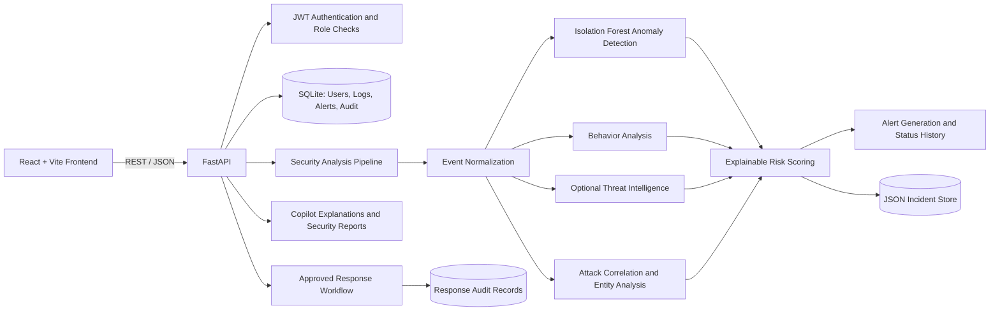

# Architecture

The React/Vite frontend uses the FastAPI REST API. The backend authenticates users with JWTs, stores security logs and alerts in SQLite, and runs the analysis pipeline for submitted events.

## System Overview

## Event Analysis Flow

1. A client submits a security event to the API or the backend reads persisted log events.
2. The normalizer standardizes event types, severity, timestamps, and evidence fields.
3. The pipeline combines anomaly detection, user-behavior signals, optional threat-intelligence enrichment, and event correlation.
4. The risk engine produces an explainable score and level from the available signals.
5. The API persists qualifying alerts and incident evidence; report endpoints produce timelines and rule-based explanations.
6. Response actions require approval and create audit records. The prototype does not directly remediate external systems.

## Storage and Runtime

- SQLite stores users, security logs, alerts, alert status history, and audit records.
- A JSON file stores incident history; Docker Compose mounts application data and model artifacts under `/app/data`.
- The backend runs with Uvicorn on port `8000`; the frontend is a separate Vite development app, normally on port `5173`.
- The dashboard uses request-driven REST updates; live WebSocket streaming is not implemented.
